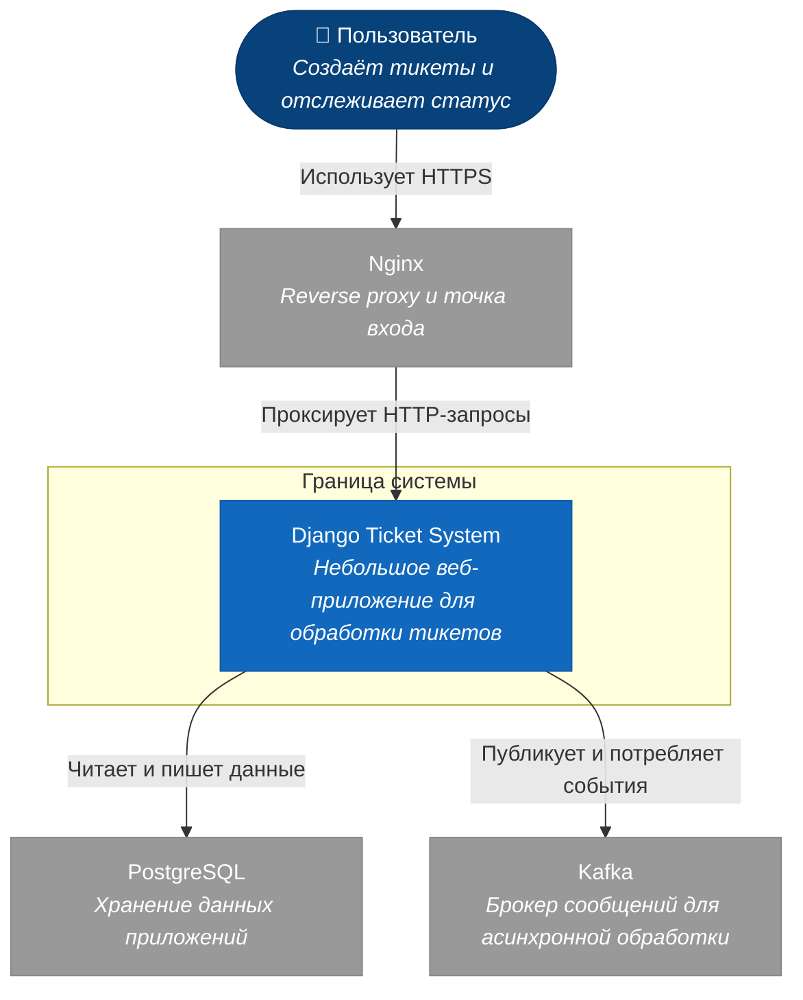

c4

#архитектура



#контейнеры
C4Container
 ```mermaid
flowchart TB
    %% Определение стилей в духе C4
    classDef person fill:#08427b,stroke:#073b6e,color:#ffffff
    classDef container fill:#438dd5,stroke:#3b7aa7,color:#ffffff
    classDef external fill:#999999,stroke:#888888,color:#ffffff
    classDef db fill:#1168bd,stroke:#0f5ca6,color:#ffffff
    classDef queue fill:#0b7c7c,stroke:#096868,color:#ffffff

    %% Элементы вне границ
    user([👤 Пользователь<br><i>Создаёт тикеты и отслеживает их статус</i>]):::person
    pg[("🗄️ PostgreSQL<br>[База данных]<br><i>Хранит тикеты, пользователей, outbox-события</i>")]:::db
    kafka[["📥 Kafka<br>[Брокер сообщений]<br><i>Транспорт событий между приложениями</i>"]]:::queue

    %% Граница Edge
    subgraph Edge ["Граница: Edge"]
        nginx["Nginx<br>[Reverse proxy]<br><i>Терминация TLS, маршрутизация запросов</i>"]:::container
    end

    %% Граница Django Application
    subgraph app ["Граница: Django Application"]
        ticket["Ticket<br>[Django app]<br><i>Сериализатор и сервис создания тикета, формирует событие</i>"]:::container
        outbox["Outbox<br>[Django app]<br><i>Хранит исходящие события, продьюсер отправляет их в Kafka</i>"]:::container
        processing["Processing<br>[Django app]<br><i>Консьюмер Kafka, хэндлер и релей событий</i>"]:::container
        notification["Notification<br>[Django app]<br><i>Отправка уведомлений пользователям</i>"]:::container
        users["Users<br>[Django app]<br><i>Управление пользователями и аутентификация</i>"]:::container
    end

        %% Связи и направления
    user -->|Использует HTTPS| nginx
    nginx -->|Проксирует HTTP-запросы| ticket
    nginx -->|Проксирует HTTP-запросы| users

    ticket -->|"Сохраняет тикет и outbox-событие [SQL]"| pg
    ticket -->|Передаёт событие создания тикета| outbox
    outbox -->|"Читает и обновляет outbox-записи [SQL]"| pg
    outbox -->|"Публикует события [Kafka protocol]"| kafka

    kafka -->|Доставляет события| processing
    processing -->|"Обновляет статусы и записи [SQL]"| pg
    processing -->|Инициирует уведомление| notification
    processing -->|Обновляет состояние тикета| ticket

    users -->|"Читает и пишет пользователей [SQL]"| pg

```
